  <picture>
    <source media="(prefers-reduced-motion: reduce)" srcset="assets/hero-still.svg">
    
  </picture>

# Cross-store price comparison: skincare and beauty at 11 US stores

**A free, open, daily price comparison of the same skincare and beauty products at 11 US online stores: matched by barcode, with the lowest price, the price gap and stock for every product, published as CSV every day and checked in public.**

**[Open the dashboard](https://siddharthkumar.com/cross-store-price-comparison/)** · **[Download today's comparison (CSV)](https://github.com/siddharthkumarx/cross-store-price-comparison/blob/main/data/latest/comparison.csv)** · [Monthly history (Parquet)](https://github.com/siddharthkumarx/cross-store-price-comparison/releases/latest) · [Run feed (JSON)](https://github.com/siddharthkumarx/cross-store-price-comparison/blob/main/data/public/feed.json)

## What does a daily cross-store price comparison give you?

One row per product sold by at least two of the stores, with each store's price, stock and link, the lowest price and the gap between the highest and the lowest. Real rows from the run of 2026-11-27 ([run log](https://github.com/siddharthkumarx/cross-store-price-comparison/actions/runs/46043579455)):

| product | lowest price | at | gap | stores in stock | matched by |
|---|---:|---|---:|---:|---|
| DR ALKAITIS · Organic Purifying Facial Cleanser | $68.00 | The Choosy Chick | 5.9% | 3 | barcode |
| OSEA · Undaria Algae Body Butter - 6.7 oz | $54.00 | Cos Bar, Credo Beauty | 3.7% | 3 | barcode |
| DR ALKAITIS · Organic Herbal Toner | $65.00 | The Choosy Chick | 3.1% | 3 | barcode |
| AUGUSTINUS BADER · The Cream Cleansing Gel - 100 ML | $74.00 | Onda Beauty | 2.7% | 3 | barcode |
| goop beauty · Colorblur Glow Balm - Velveteen (soft mauve) | $23.00 | Credo Beauty | 47.8% | 3 | name |

### What changed today

7 new lowest-price stores, 9 sold out at a store on the compared products since the previous run.

| product | change | store | before | now |
|---|---|---|---:|---:|
| Cosrx · Full Fit Propolis Synergy Toner | out of stock | Ohlolly | yes | no |
| Kosas · Weightless Lip Color - Turned On | out of stock | Ayla Beauty | yes | no |
| Kosas · Weightless Lip Color - Turned On | new lowest | Credo Beauty | Ayla Beauty | Credo Beauty |
| Kosas · Wet Stick Moisturizing Lip Shine - Skinny Dip | out of stock | Credo Beauty | yes | no |
| Kosas · Wet Stick Moisturizing Lip Shine - Skinny Dip | new lowest | Ayla Beauty, Credo Beauty | Credo Beauty | Ayla Beauty, Credo Beauty |
| LYS Beauty · Lash Confidence Mascara - Black | out of stock | Thirteen Lune | yes | no |

Every change of the day: [`data/changes/2026/2026-11-27.csv`](https://github.com/siddharthkumarx/cross-store-price-comparison/blob/main/data/changes/2026/2026-11-27.csv).

## Why can you trust these numbers?

Every run checks its own data and publishes the result. Latest run, 2026-11-27:

| check | result |
|---|---|
| Stores read completely | 11/11 |
| Rows rejected by validation | 0 |
| Prices proven to be US dollars | USD |
| Prices confirmed by a second source | 312/312 |
| Product options whose barcode has been read so far | 13.2% |
| Matching precision (blind, against barcodes) | 98.2% (389 of 396 pairs, [measured 2026-11-27](https://github.com/siddharthkumarx/cross-store-price-comparison/blob/main/data/precision/2026/2026-11-27.json)) |
| Matching method | [published, with a manual check](https://github.com/siddharthkumarx/cross-store-price-comparison/blob/main/docs/precision.md) |
| Stores that block automated readers | left out, never worked around ([sources](https://github.com/siddharthkumarx/cross-store-price-comparison/blob/main/docs/sources.md)) |

A product is compared only when the match is certain enough: same barcode, or a part-number or name match whose precision was measured against barcodes on the previous run and reached 98% on at least 100 pairs. In the run of 2026-11-27, 389 of 396 name and part-number pairs checked against barcodes were the same item. Everything below the bar is listed in [`possible_matches.csv`](https://github.com/siddharthkumarx/cross-store-price-comparison/blob/main/data/latest/possible_matches.csv) and never compared.

## How does cross-store price matching work?

  <picture>
    <source media="(prefers-reduced-motion: reduce)" srcset="assets/pipeline-still.svg">
    
  </picture>

1. **Read.** Once a day, each store's public catalog is read politely: at least 3 seconds between requests to a store, within its robots.txt rules, nothing behind a login.
2. **Match.** The same item at two stores is found by its barcode (GTIN), then by brand and manufacturer part number, then by brand, model words and options. Barcodes are read once per product and refreshed weekly.
3. **Compare.** For every product sold by two or more stores: each store's price and stock, the lowest in-stock price and the gap between highest and lowest.
4. **Publish.** A CSV, a dashboard, a change log and a run feed, with every price and stock change kept in a monthly history file.

## What broke, and how was it fixed?

- **Commits showed as "Unverified" on GitHub (2026-11-20)** (INC-001). The first commits were signed with an SSH key from the development environment that the owner's GitHub account does not hold. GitHub showed them as "Unverified" (API verification reason `unknown_key`), unlike the owner's other public repositories, whose commits are unsigned and carry no badge. *Fix:* signing switched off for this repository (`commit.gpgsign false`, `tag.gpgsign false`). The history was rewritten once with `git filter-repo`, which drops signatures and keeps authors, committers, dates and messages, and `main` was force-pushed while no live check was running. The two recon results that record the commit they ran on keep both SHAs (`git_sha`, `git_sha_before_rewrite`).
- **Five retailers throttled a second catalog read (2026-11-20)** (INC-002). In `recon-004` Cos Bar, Credo Beauty, Integrity Botanicals, Safe & Chic and The Detox Market answered HTTP 429 on `/products.json` page 3 or 4 until the retries ran out. It was the second full read of each catalog within 30 minutes; `recon-002` had read the same catalogs without a 429. *Fix:* owner decision D-016: a 429 alone is rate limiting, not a challenge. Each of the five was re-tested with one catalog read after a cool-down of at least 90 minutes (`recon-005`): three passed and are kept, two throttled again and are dropped (D-018). The daily run reads each catalog once per day, and the first daily run started more than 90 minutes after the re-test.
- **The first daily slot did not fire (2026-11-21)** (INC-003). GitHub created no `schedule` run for `daily.yml` and none for `watchdog.yml` (10:19 UTC): no run, no queued run, read from the public Actions API at 10:51 UTC. Both workflows were `active`; manual runs and push-triggered CI ran normally all night. *Fix:* the schedule rules of F1 INC-009 are ported. The daily gate (`python -m crossprice.schedule gate`) lets a dispatch that names its slot fill it, so an on-time external trigger can start each run at 07:43 UTC; GitHub's late event then skips. The watchdog's dispatch is marked `by=watchdog`. A slot now counts as late, not missed, when a good run starts later the same UTC day, and the on-time count starts with the first triggered slot. The 2026-11-21 slot was filled by hand at 10:54 UTC (dispatch with `slot` and `by=manual`).
- **A product title with an inch mark crashed the history merge (2026-11-21)** (INC-004). All 11 retailers were read, then the run stopped in the history step with `Value with unterminated quote found` on line 3,260 of the previous snapshot (`data/latest/offers.csv`): the Cos Bar title `T3 SINGLEPASS CURL 1.25" SATIN BLUSH`, written as valid CSV with the quote doubled. The run was recorded as `crashed`; the snapshot, the GTIN cache and the monthly Parquet file were left unchanged, so no data was lost or half-written. *Fix:* the snapshot is read with the dialect stated (`delim ','`, `quote '"'`, `escape '"'`, no auto-detection). A regression test writes 3,999 plain rows and one title with an inch mark and a comma, and reads them back unchanged; it fails on the old query.
- **CI failed on a type error, then on a product id read as a secret (2026-11-21)** (INC-005). First, `mypy` rejected a test that called `.startswith` on a value typed `object`; the tests had been run locally, the type check had not. Once that was fixed, the secret scan reported 6 findings in `data/latest/price-index.json` as committed by the run of 12:41 UTC. *Fix:* the type is narrowed in the test. `.gitleaks.toml` keeps the default rules and exempts from that one rule only values that are exactly this id format (`^M[0-9a-f]{13}$`); everything else in every file is still scanned.
- **Dermsilk throttled a daily read; its absence showed as price changes (2026-11-22)** (INC-006). Dermsilk answered pages 1 to 4 of `/products.json` and then HTTP 429 on page 5, four times over 200 seconds, until the retries ran out. Its previous read was 27 hours earlier, so this is not the second-read pattern of INC-002. The other 10 retailers were read normally. Then the change log recorded 8 `new_lowest` events, and none of them was a price move. In 6, Dermsilk had shared the lowest price and dropped out of the set because it was not read. In the other 2, Onda Beauty dropped out because its listing had been matched by name on the previous run, and this run compared barcode matches only. *Fix:* `new_lowest` is now decided only among the retailers priced in both runs, like the rule that products new to or gone from the comparison raise no event. A regression test removes a tied-lowest retailer and expects no event. The 8 events stay in `data/changes/2026/2026-11-22.csv` as that run wrote them. For Dermsilk, D-016 applies: a 429 alone is rate limiting, not a challenge. If it throttles again on the next runs, it gets one re-test after a cool-down and is dropped if it throttles again, as in D-018.

The full log, with the evidence for each: [`docs/incidents.md`](https://github.com/siddharthkumarx/cross-store-price-comparison/blob/main/docs/incidents.md).

## Who uses cross-store price data?

- **Brands** that sell through several retailers and want to see where their products are cheapest, out of stock or on sale.
- **Retailers** that want their prices next to the same products at other stores, every morning.
- **Analysts and investors** who follow pricing and stock in a category over time.

## Want this for your own stores?

The same pipeline works for your products and the stores you choose. You get a **free sample first**: your products at your competitors, compared, as a CSV or Google Sheet. Then daily or weekly delivery as CSV, Excel, Google Sheets or straight into your database.

**[Ask for a free sample](https://steadydata.co/contact/)** · or email [hello@steadydata.co](mailto:hello@steadydata.co)

## How is this different from Prisync, Price2Spy or checking by hand?

| | This project / SteadyData | Prisync | Price2Spy | Checking by hand |
|---|---|---|---|---|
| Setup | done for you | you, in their app | you, in their app | you |
| Same-product matching | barcode, then part number, then name; precision measured and published | you link the products, or use the tool's matching | you link the products, or use the tool's matching | by eye |
| Delivery | CSV, Google Sheets or your database, plus a dashboard | their web app and exports | their web app and exports | a spreadsheet you keep up |
| Cost | per project, free sample first | monthly subscription | monthly subscription | your time |
| Best for | data delivered and checked | a self-serve tool | a self-serve tool | a few products, now and then |

## FAQ

**How often is the comparison updated?** Once a day, at 07:43 UTC. The badges above show the last run and how many runs there have been.

**Which stores are compared?** 11 US online stores: Ayla Beauty, Cos Bar, Credo Beauty, Dermsilk, Ohlolly, Onda Beauty, Petit Vour, Safe & Chic, Soko Glam, The Choosy Chick, Thirteen Lune. How they were chosen, and why other stores were left out, is in [`docs/sources.md`](https://github.com/siddharthkumarx/cross-store-price-comparison/blob/main/docs/sources.md).

**Why are so few products compared?** The 11 stores sell clean, Korean and luxury beauty, and most of their brands are sold by one of them only. In the recon before launch, the share of a store's products also sold by another of the stores was 15% at best and 1 to 7% for most, below the 30% this project aimed for ([decisions D-002, D-018](https://github.com/siddharthkumarx/cross-store-price-comparison/blob/main/docs/decisions.md)). The compared set grows as more barcodes are read each day.

**How do you know two stores sell the same product?** By barcode first. Name and part-number matches are used only above a threshold whose precision was measured against barcodes, and 100 compared pairs are checked by hand ([method](https://github.com/siddharthkumarx/cross-store-price-comparison/blob/main/docs/precision.md)).

**What does "price gap" mean?** The highest in-stock price minus the lowest, as a percentage of the lowest, for one product on one day. It is a number, not a judgment of any store.

**Is reading store prices allowed?** Only public product pages and public catalog feeds are read, within each store's robots.txt rules, slowly, and with a name that links back here. No logins, no personal data, no images or descriptions are kept. A store can opt out by email.

**Can I get my own products and competitors?** Yes, see [Want this for your own stores?](#want-this-for-your-own-stores). The first sample is free.

## Data dictionary

`data/latest/comparison.csv`, one row per compared product. Example values from the run of 2026-11-27.

| field | type | meaning | example |
|---|---|---|---|
| `product_key` | text | The product's GTIN-14 barcode, or `M` + a stable id for a non-barcode match | M34f02d74653ad |
| `brand` | text | Brand, as the first store lists it | 28 Litsea |
| `product` | text | Product name and option (shade, size), as the first store lists it | Top Note Minted Juniper Body Oil |
| `gtin` | 14 digits or empty | GTIN-14 barcode when the match is barcode-verified | (empty) |
| `match_tier` | text | `gtin` (barcode), `mpn` (brand + part number) or `fuzzy` (brand + name) | fuzzy |
| `match_confidence` | 0 to 1 | Score of the weakest link in the match; 1.00 for barcode | 1.00 |
| `retailers` | integer | Stores that sell the product | 2 |
| `retailers_in_stock` | integer | Stores that have it in stock | 2 |
| `lowest_price_usd` | USD | Lowest in-stock price (lowest of all when none is in stock) | 24.00 |
| `lowest_price_retailers` | text | Store id(s) at the lowest price | safe-chic the-choosy-chick |
| `highest_price_usd` | USD | Highest in-stock price | 24.00 |
| `spread_pct` | percent or empty | (highest - lowest) / lowest x 100, in-stock prices, 2+ stores | 0.0 |
| `<store>_price_usd` | USD or empty | That store's price (one column per store) | see the per-store columns |
| `<store>_in_stock` | yes / no / empty | That store's stock | see the per-store columns |
| `<store>_url` | URL or empty | The product page at that store | see the per-store columns |

Other files: [`offers.csv`](https://github.com/siddharthkumarx/cross-store-price-comparison/blob/main/data/latest/offers.csv) (every product option at every store), [`possible_matches.csv`](https://github.com/siddharthkumarx/cross-store-price-comparison/blob/main/data/latest/possible_matches.csv), [`price-index.json`](https://github.com/siddharthkumarx/cross-store-price-comparison/blob/main/data/latest/price-index.json) (the "your price vs competitors" demo), the [change log](https://github.com/siddharthkumarx/cross-store-price-comparison/tree/main/data/changes), [`runs.jsonl`](https://github.com/siddharthkumarx/cross-store-price-comparison/blob/main/data/runs.jsonl) and the [dataset card](https://github.com/siddharthkumarx/cross-store-price-comparison/blob/main/data/README.md).

<b>For engineers</b>

- **Stack:** Python 3.12, httpx, Protego (robots.txt), Pydantic, DuckDB (SCD2 history), PyArrow (Parquet), GitHub Actions, GitHub Pages. ruff, mypy strict, pytest.
- **Pipeline:** `src/crossprice/run.py`: collect (catalogs, then GTIN probes within a fixed budget) → validate (Pydantic, batch guard) → match (`match.py`) → blind precision (`precision.py`) → compare (`compare.py`) → SCD2 merge (`history.py`) → outputs.
- **Politeness:** one runner per run, at least 3 s between requests per host, one run-wide pace, a 429 pauses the whole run, a challenge stops the store ([decisions D-004, D-016](https://github.com/siddharthkumarx/cross-store-price-comparison/blob/main/docs/decisions.md)).
- **Docs:** [architecture](https://github.com/siddharthkumarx/cross-store-price-comparison/blob/main/docs/architecture.md), [decisions](https://github.com/siddharthkumarx/cross-store-price-comparison/blob/main/docs/decisions.md), [plan](https://github.com/siddharthkumarx/cross-store-price-comparison/blob/main/docs/plan.md), [sources](https://github.com/siddharthkumarx/cross-store-price-comparison/blob/main/docs/sources.md), [precision](https://github.com/siddharthkumarx/cross-store-price-comparison/blob/main/docs/precision.md), [incidents](https://github.com/siddharthkumarx/cross-store-price-comparison/blob/main/docs/incidents.md), [maintainers](https://github.com/siddharthkumarx/cross-store-price-comparison/blob/main/docs/maintainers.md).
- **Run locally:** `uv sync && uv run pytest`. Live requests run only on GitHub Actions (`checks.yml` for recon, `daily.yml` for the pipeline).
- **Reuse:** the polite HTTP client, witnesses, validation, history and status come from the store monitor [ecommerce-price-monitor](https://github.com/siddharthkumarx/ecommerce-price-monitor).

## Data use and compliance

Public prices and stock only, read from public pages within robots.txt rules. No personal data, no images, no product descriptions. Prices are shown as found; differences are shown as numbers. Store and product names belong to their owners. A store that wants to be left out can email [hello@steadydata.co](mailto:hello@steadydata.co); it is removed within 24 hours.

## License

Code: [MIT](LICENSE). Data: prices and stock are facts; the compiled dataset is shared under CC BY 4.0 with attribution to this repository.

---

Built and maintained by Siddharth Kumar, founder of SteadyData · [steadydata.co](https://steadydata.co) · [siddharthkumar.com](https://siddharthkumar.com)
